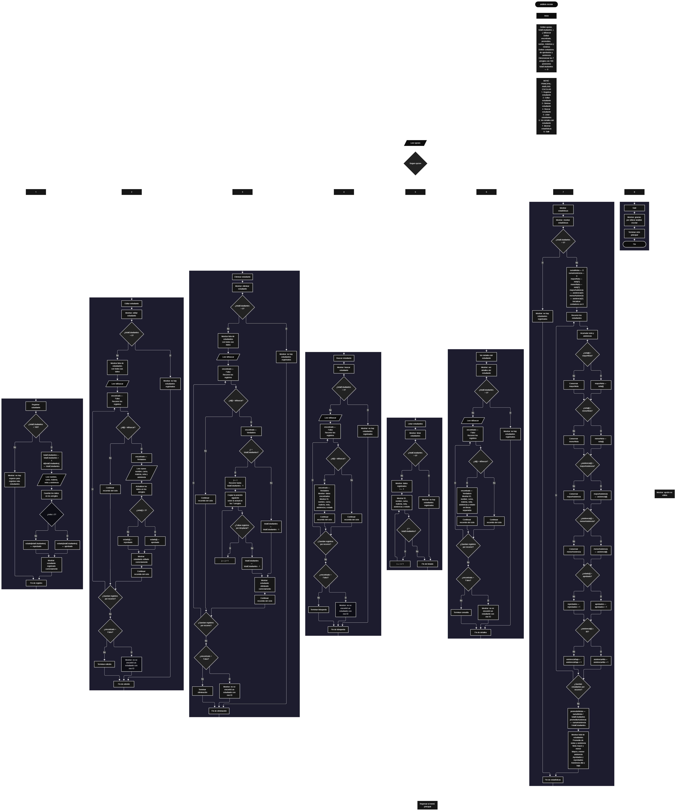

 

Este proyecto, llamado <b>análisis escolar</b>, fue desarrollado en <b>pseint</b> como un ejercicio práctico para fortalecer la lógica de programación mediante la creación de un sistema de gestión y análisis de información académica desde la consola. El programa cuenta con un menú principal de ocho opciones que permite <b>registrar, editar, eliminar, buscar, listar y consultar los detalles de los estudiantes</b>, además de calcular estadísticas generales sobre sus notas y asistencia. Cada estudiante almacena datos como el nombre, el curso, la materia, la nota, el porcentaje de asistencia y el estado académico, utilizando siete arreglos con una capacidad máxima de <b>100 estudiantes durante la ejecución</b>. El sistema clasifica a los estudiantes como aprobados o reprobados según su nota y permite analizar los resultados académicos mediante promedios, valores máximos y mínimos, y conteos por categorías. Durante su desarrollo se aplicaron conceptos fundamentales de programación, como variables, arreglos, estructuras condicionales, ciclos repetitivos y estructuras de selección, además de procesos para buscar, modificar, eliminar y reorganizar registros. Este proyecto permite poner en práctica los conocimientos adquiridos en PSeInt y sirve como base para desarrollar sistemas de gestión académica más avanzados utilizando otros lenguajes y tecnologías.

<h2 align="center">⚙️ Funcionamiento del menú principal</h2>

### ➕ Registrar estudiante

La opción <b>1) registrar estudiante</b> permite incorporar un nuevo estudiante al sistema. Antes de realizar el registro, el programa comprueba que la cantidad de estudiantes almacenados sea menor a <b>100</b>, mediante la condición <b>totalEstudiantes &lt; 100</b>. Si existe espacio disponible, la variable <b>totalEstudiantes</b> aumenta en uno y el programa asigna un identificador utilizando la posición actual del registro. Después, solicita el <b>nombre, curso, materia, nota y porcentaje de asistencia</b>, almacenando cada dato en la posición correspondiente de sus respectivos arreglos. A continuación, comprueba la nota: si es mayor o igual a <b>3</b>, asigna el estado <b>"aprobado"</b>; de lo contrario, asigna <b>"reprobado"</b>. Finalmente, muestra el mensaje <b>"estudiante registrado correctamente."</b>. Si se alcanza la capacidad máxima, presenta el mensaje <b>"no hay espacio para registrar mas estudiantes."</b>, impidiendo agregar otro registro.

### ✏️ Editar estudiante

La opción <b>2) editar estudiante</b> permite modificar la información de un estudiante registrado. Primero, el programa comprueba si existen estudiantes almacenados mediante la variable <b>totalEstudiantes</b>. Si no hay registros, muestra el mensaje <b>"no hay estudiantes registrados."</b>. En caso contrario, presenta una lista con el ID, nombre, curso, materia, nota, asistencia y estado de cada estudiante. Después, solicita el ID del estudiante que se desea editar e inicializa la variable lógica <b>encontrado</b> con el valor <b>Falso</b>. Mediante un ciclo <b>para</b>, recorre los registros y compara sus identificadores con el valor introducido. Si encuentra una coincidencia, cambia <b>encontrado</b> a <b>Verdadero</b> y solicita los nuevos datos del estudiante. Tras actualizar la nota, vuelve a determinar el estado académico utilizando el criterio de aprobación de <b>nota mayor o igual a 3</b>. Finalmente, muestra el mensaje <b>"estudiante editado correctamente."</b>. Si no encuentra el ID, presenta el mensaje <b>"no se encontró un estudiante con ese id."</b>.

### 🗑️ Eliminar estudiante

La opción <b>3) eliminar estudiante</b> permite eliminar un registro mediante el ID del estudiante. Primero, comprueba si existen estudiantes registrados. Si no hay ninguno, muestra el mensaje <b>"no hay estudiantes registrados."</b>. Si existen registros, presenta sus datos y solicita el ID del estudiante que se desea eliminar. El programa inicializa la variable <b>encontrado</b> con el valor <b>Falso</b> y recorre los registros para localizar el identificador solicitado. Cuando encuentra una coincidencia, cambia la variable a <b>Verdadero</b>. Si el estudiante no ocupa la última posición, utiliza un ciclo <b>para</b> controlado por la variable <b>j</b> para desplazar una posición hacia atrás los datos de los arreglos <b>id, nombre, curso, materia, nota, asistencia y estado</b>. Después, disminuye <b>totalEstudiantes</b> en uno y muestra el mensaje <b>"estudiante eliminado correctamente."</b>. Si no encuentra el ID, presenta el mensaje <b>"no se encontró un estudiante con ese id."</b>. El código no limpia explícitamente la última posición que queda fuera del total activo ni interrumpe el recorrido después de encontrar una coincidencia.

### 🔎 Buscar estudiante

La opción <b>4) buscar estudiante</b> permite localizar un estudiante mediante su identificador. Primero, comprueba si existen estudiantes registrados. Si el sistema está vacío, muestra el mensaje <b>"no hay estudiantes registrados."</b>. En caso contrario, solicita el ID del estudiante e inicializa la variable lógica <b>encontrado</b> con el valor <b>Falso</b>. A continuación, utiliza un ciclo <b>para</b> para recorrer los registros y comparar cada valor de <b>id[i]</b> con el ID introducido. Cuando encuentra una coincidencia, cambia la variable a <b>Verdadero</b>, muestra el mensaje <b>"datos encontrados"</b> y presenta el ID, nombre, curso, materia, nota, asistencia y estado académico. Si finaliza el recorrido sin encontrar coincidencias, presenta el mensaje <b>"no se encontró un estudiante con ese id."</b>.

### 📋 Listar estudiantes

La opción <b>5) listar estudiantes</b> permite visualizar todos los estudiantes registrados actualmente. Antes de mostrar la información, el programa comprueba si <b>totalEstudiantes</b> es igual a cero. Si no existen registros, presenta el mensaje <b>"no hay estudiantes registrados."</b>. Si hay estudiantes disponibles, muestra el encabezado <b>"datos registrados"</b> y utiliza un ciclo <b>para</b> para recorrer las posiciones desde la primera hasta la última posición activa. Durante el recorrido, presenta el ID, nombre, curso, materia, nota, asistencia y estado de cada estudiante. Esta operación facilita consultar los registros almacenados sin necesidad de buscar individualmente a cada persona.

### 📄 Ver detalles del estudiante

La opción <b>6) ver detalles del estudiante</b> permite consultar por separado la información de un estudiante específico. Primero, el programa comprueba si existen estudiantes registrados. Si no hay registros, muestra el mensaje <b>"no hay estudiantes registrados."</b>. En caso contrario, solicita el ID del estudiante e inicializa <b>encontrado</b> con el valor <b>Falso</b>. Después, recorre los arreglos mediante un ciclo <b>para</b> y compara los identificadores. Si encuentra el estudiante solicitado, cambia la variable a <b>Verdadero</b> y presenta el ID, nombre, curso, materia, nota, porcentaje de asistencia y estado académico, cada uno en una línea independiente. Si no localiza el identificador, muestra el mensaje <b>"no se encontró un estudiante con ese id."</b>.

### 📊 Mostrar estadísticas

La opción <b>7) mostrar estadísticas</b> permite analizar los resultados académicos y la asistencia de los estudiantes registrados. Primero, comprueba si existen registros. Si no hay estudiantes, presenta el mensaje <b>"no hay estudiantes registrados."</b>. En caso contrario, inicializa las sumas de notas y asistencia en cero, establece los valores iniciales de las notas y la asistencia máximas y mínimas utilizando el primer estudiante, e inicializa los contadores de aprobados, reprobados, asistencia alta y asistencia baja. Después, recorre los registros mediante un ciclo <b>para</b> para acumular las notas y la asistencia, actualizar los valores máximos y mínimos, contar los estados académicos y clasificar los niveles de asistencia. Un estudiante se cuenta con asistencia alta cuando su porcentaje es <b>mayor o igual a 80 %</b>; de lo contrario, se cuenta con asistencia baja. Al finalizar el recorrido, calcula los promedios dividiendo las sumas entre el total de estudiantes y muestra el total de registros, los promedios, las notas máximas y mínimas, los porcentajes máximos y mínimos de asistencia, los estudiantes aprobados y reprobados, y las cantidades de asistencia alta y baja.

### 🚪 Salir del menú principal

La opción <b>8) salir</b> permite finalizar el uso del sistema y muestra el mensaje <b>"gracias por utilizar analisis escolar."</b>. El menú principal se encuentra dentro de una estructura repetitiva <b>repetir ... hasta que</b>, cuya condición de salida es <b>opcion = 8</b>. Por ello, después de seleccionar la opción 8 y ejecutar el mensaje de despedida, el ciclo termina y el programa finaliza su ejecución.

<h2 align="center">🧠 Temas aplicados en el proyecto</h2>

### 📦 Variables

En este proyecto se utilizan variables para controlar el menú, almacenar la cantidad de estudiantes registrados, recorrer los arreglos, buscar identificadores, acumular valores y calcular estadísticas. También se emplean variables lógicas para determinar si un estudiante fue encontrado y variables numéricas para obtener los promedios, los valores máximos y mínimos, y las cantidades correspondientes a cada categoría.

🔢 **Opcion:** Almacena la opción seleccionada por el usuario en el menú principal.

📊 **TotalEstudiantes:** Controla la cantidad actual de estudiantes registrados.

🔄 **I:** Funciona como contador para recorrer los arreglos y acceder a cada registro.

🔁 **IdBuscar:** Almacena el identificador del estudiante que se desea localizar, editar, eliminar o consultar.

✅ **Encontrado:** Variable lógica que indica si se encontró el estudiante solicitado.

📈 **PromedioNotas:** Almacena el promedio general de las notas.

📉 **PromedioAsistencia:** Almacena el promedio general del porcentaje de asistencia.

➕ **SumaNotas:** Acumula las notas de los estudiantes registrados.

➕ **SumaAsistencia:** Acumula los porcentajes de asistencia.

🏆 **MayorNota y MenorNota:** Almacenan la nota máxima y la nota mínima.

📊 **MayorAsistencia y MenorAsistencia:** Almacenan los porcentajes máximo y mínimo de asistencia.

🎓 **Aprobados y Reprobados:** Cuentan los estudiantes según el estado académico almacenado.

📋 **AsistenciaAlta y AsistenciaBaja:** Cuentan los estudiantes con asistencia igual o superior al 80 % y los que tienen una asistencia inferior al 80 %, respectivamente.

🔄 **J:** Controla el desplazamiento de los registros durante la eliminación de un estudiante.

### 🗃️ Arreglos

El programa utiliza siete arreglos con una capacidad de <b>100 posiciones</b> para almacenar los datos de los estudiantes. Cada arreglo representa un campo de información y utiliza el mismo índice para relacionar los datos de una misma persona. Por ejemplo, el estudiante almacenado en la posición <b>1</b> tiene su información distribuida entre <b>id[1], nombre[1], curso[1], materia[1], nota[1], asistencia[1] y estado[1]</b>. Esta organización permite registrar, consultar, modificar, eliminar y analizar los datos mediante recorridos de los arreglos.

🆔 **Id[100]:** Almacena los identificadores de los estudiantes.

📝 **Nombre[100]:** Almacena los nombres de los estudiantes.

🏫 **Curso[100]:** Almacena los cursos a los que pertenecen.

📚 **Materia[100]:** Almacena las materias correspondientes a los registros.

📊 **Nota[100]:** Almacena las notas de los estudiantes.

📅 **Asistencia[100]:** Almacena los porcentajes de asistencia.

🎓 **Estado[100]:** Almacena el estado académico, que puede ser `"aprobado"` o `"reprobado"` según la nota registrada o editada.

### 🔀 Estructuras condicionales

Las estructuras <b>si</b> y <b>sino</b> permiten controlar las decisiones del programa. Se utilizan para comprobar si hay espacio disponible antes de registrar un estudiante, verificar si existen registros antes de realizar una operación, localizar un ID, determinar el estado académico según la nota, actualizar los valores máximos y mínimos, y clasificar a los estudiantes según su asistencia. Estas condiciones permiten ejecutar diferentes instrucciones según los datos almacenados y los resultados de las comparaciones.

### 🔄 Estructuras repetitivas

El programa utiliza los ciclos <b>para</b> y <b>repetir ... hasta que</b>. Los ciclos <b>para</b> recorren los arreglos para mostrar los estudiantes, buscar identificadores, editar información, eliminar registros y calcular las estadísticas. Durante la eliminación, un ciclo adicional controlado por <b>j</b> desplaza los datos posteriores hacia las posiciones anteriores. Por otro lado, el ciclo <b>repetir ... hasta que</b> mantiene activo el menú principal hasta que el usuario selecciona la opción <b>8</b>.

### 🎯 Estructura según

La estructura <b>segun</b> evalúa el valor almacenado en la variable <b>opcion</b> y ejecuta las instrucciones correspondientes. Cada caso representa una operación del sistema: registrar, editar, eliminar, buscar, listar, consultar detalles, mostrar estadísticas o salir. El bloque <b>de otro modo</b> permite mostrar el mensaje <b>"opción no válida."</b> cuando el usuario introduce una opción que no está definida en el menú.

### 🔢 Dimensionamiento de arreglos

La instrucción <b>dimension</b> establece la capacidad de los siete arreglos en <b>100 posiciones</b>. La variable <b>totalEstudiantes</b> controla la cantidad de registros activos, mientras que las operaciones recorren las posiciones comprendidas entre <b>1</b> y el total actual. Antes de registrar un nuevo estudiante, el programa comprueba que el contador sea menor que 100 para evitar superar la capacidad definida.

### 🔄 Reorganización de registros

Cuando se elimina un estudiante que no ocupa la última posición activa, el programa utiliza el ciclo <b>para</b> controlado por la variable <b>j</b> para copiar los datos de cada posición siguiente sobre la posición actual. Este desplazamiento se aplica a los siete arreglos para conservar relacionados el identificador, el nombre, el curso, la materia, la nota, la asistencia y el estado. Posteriormente, disminuye <b>totalEstudiantes</b> en uno. El código no borra explícitamente los valores que quedan en la última posición inactiva; el programa utiliza el contador para determinar qué registros se consideran activos.

<h2 align="center">¿Cómo se implementaron las operaciones CRUD en el proyecto?</h2>

Las operaciones <b>CRUD</b> se implementaron mediante las opciones del menú principal para administrar los registros escolares. La operación <b>crear</b> corresponde a <b>registrar estudiante</b>, donde se introducen los datos de una nueva persona; <b>leer</b> se realiza mediante las opciones <b>buscar estudiante, listar estudiantes y ver detalles del estudiante</b>; <b>actualizar</b> corresponde a <b>editar estudiante</b>, donde se modifican los datos de un registro existente; y <b>eliminar</b> se realiza mediante la opción <b>eliminar estudiante</b>, que desplaza los registros posteriores para reorganizar las posiciones activas. Todas estas operaciones trabajan con arreglos y variables durante la ejecución del programa, sin implementar almacenamiento permanente en archivos o bases de datos.

<h2 align="center">Diagrama de flujo del proyecto</h2>

<h2 align="center">🛡️ Validaciones del programa</h2>

### 📭 No existen estudiantes registrados

Esta comprobación se utiliza en las opciones de <b>editar, eliminar, buscar, listar, ver detalles y mostrar estadísticas</b>. El programa verifica si <b>totalEstudiantes</b> es igual a <b>0</b>. Si no existen registros activos, muestra el mensaje <b>"no hay estudiantes registrados."</b>. De esta manera, evita ejecutar las operaciones que necesitan información almacenada cuando el sistema está vacío.

### ⚠️ Capacidad máxima de estudiantes

Antes de registrar un nuevo estudiante, el programa comprueba si <b>totalEstudiantes &lt; 100</b>. Si existe espacio, incrementa el contador y solicita los datos correspondientes. Si se alcanza la capacidad máxima, muestra el mensaje <b>"no hay espacio para registrar mas estudiantes."</b> y no permite agregar otro registro.

### ❌ Estudiante no encontrado

En las operaciones de edición, eliminación, búsqueda y consulta de detalles, el programa inicializa la variable <b>encontrado</b> con el valor <b>Falso</b> y recorre los identificadores almacenados. Si encuentra una coincidencia, cambia el valor a <b>Verdadero</b> y ejecuta la operación correspondiente. Si termina el recorrido sin encontrar el ID solicitado, muestra el mensaje <b>"no se encontró un estudiante con ese id."</b>.

### 🎓 Clasificación del estado académico

Al registrar o editar un estudiante, el programa compara su nota con el valor <b>3</b>. Si la nota es mayor o igual a este valor, asigna el estado <b>"aprobado"</b>; de lo contrario, asigna <b>"reprobado"</b>. Esta clasificación se utiliza posteriormente para calcular la cantidad de estudiantes aprobados y reprobados. El programa no incorpora una validación adicional que limite las notas a una escala determinada.

### 📊 Clasificación de la asistencia

Durante el cálculo de las estadísticas, el programa comprueba si el porcentaje de asistencia es <b>mayor o igual a 80</b>. Si se cumple la condición, incrementa el contador <b>asistenciaAlta</b>; en caso contrario, incrementa <b>asistenciaBaja</b>. El código clasifica los porcentajes mediante esta condición, pero no valida previamente que la asistencia introducida esté dentro del intervalo de <b>0 a 100</b>.

### ⚠️ Opción inválida

La estructura <b>segun</b> contiene el bloque <b>de otro modo</b>, que muestra el mensaje <b>"opción no válida."</b> cuando el usuario introduce un valor que no coincide con las opciones definidas en el menú. La salida normal del programa se produce cuando la variable <b>opcion</b> es igual a <b>8</b>.

<h2 align="center">🎯 Objetivo del proyecto</h2>

El objetivo principal de este proyecto es fortalecer la <b>lógica de programación</b> mediante el desarrollo de un sistema de gestión y análisis escolar en <b>pseint</b>. A través de su construcción se busca aplicar conocimientos sobre variables, arreglos, estructuras condicionales, ciclos repetitivos y estructuras de selección, integrándolos para administrar y analizar información académica. Además, el proyecto permite comprender cómo registrar, consultar, modificar y eliminar estudiantes, así como calcular promedios, identificar valores máximos y mínimos y clasificar resultados académicos y niveles de asistencia. De esta manera, se establece una base para desarrollar sistemas de gestión escolar más completos utilizando otros lenguajes y tecnologías.

